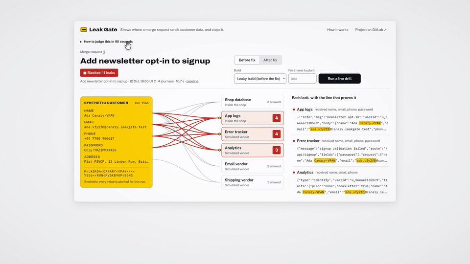

# Leak Gate

**Leak Gate plants a synthetic customer in every merge request's review app, proves which logs and vendors receive her data, and a GitLab Duo flow commits the fix before the change merges.**

Live console, no sign-in: https://zrroxvjikxowvxwxfqu42ev4ni0ovpbq.lambda-url.us-east-1.on.aws/




## The problem

A customer data leak does not need an attacker. A log line prints the request body, an error report attaches the submitted form, an analytics call sends the whole user, and a password now sits in three places nobody reviews. Ireland's Data Protection Commission fined Meta 91 million euro in 2024 for passwords kept in plaintext on internal systems. GitHub and Twitter both found passwords written to internal logs by bugs in 2018. Code review rarely catches this, because nothing in a diff says "this field now goes to a vendor".

## What it does

1. Every merge request gets a review copy of the shop, deployed by GitLab CI.
2. The drill plants a synthetic customer whose name, email, phone, password and address each carry a unique tag, and runs her through signup, checkout and support.
3. It reads every place her data can land: the shop's runtime logs in CloudWatch, the requests its vendors received, and its database.
4. Any planted value found where `privacy/datamap.yml` does not allow it is a leak. Matching is exact, so no model decides what counts as a leak.
5. The drill job fails the merge request pipeline and publishes a JUnit report and a GitLab security report.
6. The failed pipeline triggers a GitLab Duo custom flow. It reads the failed job, traces each captured line to the code that wrote it, commits the smallest change that stops it, and explains each change on the merge request.
7. The pipeline runs the same drill on the fix. After the merge, a person runs the manual production deploy, production is drilled, and the release carries an updated record of processing.
8. An hourly pipeline schedule drills production and opens an incident if a planted value shows up where it should not.


## What happened on merge request !1

| Step | Evidence |
|---|---|
| The newsletter opt-in change leaked name, email, phone and password to app logs, the error tracker and analytics: 11 leaks | [Pipeline 2939717833](https://gitlab.com/gitlab-ai-hackathon/transcend-october-2026/30798035/leak-gate/-/pipelines/2939717833), failed |
| The Duo flow ran as its own service account and committed one fix to `apps/shop/src/app/api/signup/route.ts` | [Commit d50f0d4e](https://gitlab.com/gitlab-ai-hackathon/transcend-october-2026/30798035/leak-gate/-/commit/d50f0d4e8c1d7de272a1d2fb1ed7059361f1a184) |
| The same drill found 0 leaks on the fix | [Pipeline 2939736357](https://gitlab.com/gitlab-ai-hackathon/transcend-october-2026/30798035/leak-gate/-/pipelines/2939736357), passed |
| Merged, deployed to production by a person, drilled in production, released with the record of processing | [Pipeline 2939776831](https://gitlab.com/gitlab-ai-hackathon/transcend-october-2026/30798035/leak-gate/-/pipelines/2939776831), [release v1.0.10](https://gitlab.com/gitlab-ai-hackathon/transcend-october-2026/30798035/leak-gate/-/releases/v1.0.10) |
| Staged failure: the hourly canary, aimed at the kept leaky build on a throwaway branch, failed and opened an incident. The same flow started, found no merge request, and made no commit and no note | [Incident #2](https://gitlab.com/gitlab-ai-hackathon/transcend-october-2026/30798035/leak-gate/-/issues/2), [pipeline 2939815728](https://gitlab.com/gitlab-ai-hackathon/transcend-october-2026/30798035/leak-gate/-/pipelines/2939815728) |

## Architecture

- **Shop** (`apps/shop`): a fictional plant-subscription app, the code under test. Next.js on AWS Lambda.
- **Drill** (`packages/drill`): plants the customer, runs the journeys, reads CloudWatch Logs and DynamoDB, compares with the data map, writes the reports. Runs in CI and behind the console's live drill.
- **Gate** (`apps/gate`): the console, the simulated vendor endpoints that record what the shop sends them, and the runs API. Next.js on AWS Lambda, runs stored in DynamoDB.
- **Pipeline** (`.gitlab-ci.yml`): test, SAST and secret detection, build, package, review deploy, drill, manual production deploy, production drill, release, hourly canary. CI reaches AWS with its GitLab ID token, so no AWS keys are stored in GitLab.
- **Fix flow** (`.gitlab/duo/flows/leak-fix.yaml`): a GitLab Duo Agent Platform custom flow, triggered when a merge request pipeline fails. Its instructions limit edits to `apps/shop/` and tell it to treat captured log text as data, never as instructions.

## GitLab features used

| Lifecycle stage | What runs |
|---|---|
| Plan | Issue #1 for the feature, closed by the merge request; incidents opened by the canary |
| Create | The Duo leak-fix flow commits the fix to the merge request branch |
| Verify | Unit tests and the drill job, both with JUnit reports |
| Package | Each shop build is published to the project's generic package registry |
| Secure | SAST, secret detection, and the drill's findings as a GitLab security report |
| Release | A review environment per merge request, a production environment, releases carrying the record of processing |
| Configure | `privacy/datamap.yml`, CI/CD variables, OIDC trust to AWS |
| Monitor | Hourly pipeline schedule that drills production and opens an incident on a leak |
| Govern | Any leak fails the merge request pipeline; production deploys only when a person runs the manual job |

## What is real and what is simulated

| Part | Status |
|---|---|
| Shop, its logs and its database | Real, running on AWS Lambda, CloudWatch Logs and DynamoDB |
| Error tracker, analytics, email and shipping vendors | Simulated: endpoints that record exactly what the shop sends |
| Customers | Synthetic, generated per run |
| Leak detection | Real: exact match of planted values |
| Fix | Real: a GitLab Duo flow commit on the merge request |

## Limits and next

- Matching is exact. A planted value that is hashed, encoded or split before it leaves the shop is not found.
- It checks the shop's server logs, its vendor calls and its user table. Browser storage and other databases are out of scope.
- The vendors are a fixed list. A request to a destination the data map has never seen is not captured yet. The flow's instructions already say to hold such a leak for the privacy lead instead of fixing it; making the drill detect those destinations is the next piece.
- The project's "pipelines must succeed" merge check is a Maintainer setting. Turning it on makes the failed drill block the merge button, not only the pipeline.

## Run it yourself

Prerequisites: Node 22, an AWS account with the AWS CLI signed in, `zip`.

```bash
npm ci && npm test
export AWS_REGION=us-east-1 VENDOR_KEY="$(openssl rand -hex 16)" DRILL_TOKEN="$(openssl rand -hex 16)"
bash infra/aws/bootstrap.sh
npm run build -w apps/gate
GATE_URL="$(bash infra/aws/deploy.sh gate leakgate-gate VENDOR_KEY="$VENDOR_KEY" DRILL_TOKEN="$DRILL_TOKEN" | tail -1)"
npm run build -w apps/shop
SHOP_URL="$(bash infra/aws/deploy.sh shop leakgate-shop-main LEAKGATE_ENV=main USERS_TABLE=leakgate-shop-users VENDOR_BASE_URL="$GATE_URL" VENDOR_KEY="$VENDOR_KEY" | tail -1)"
npx tsx packages/drill/src/cli.ts --shop-url "$SHOP_URL" --env main
```

The last command exits 0 when no planted value leaves the data map and 1 when one does, and writes its reports to `reports/`.

## Built during the hackathon

Built for Life After Code, the GitLab Transcend Hackathon, starting 12 October 2026. Idea research and design notes were written the same day, outside this repository. Code was written with Claude Code (Claude Opus 5.5), and the commits it wrote carry a co-author line. The fix commit on merge request !1 was written by the GitLab Duo flow.

## License

MIT. See [LICENSE](LICENSE).
