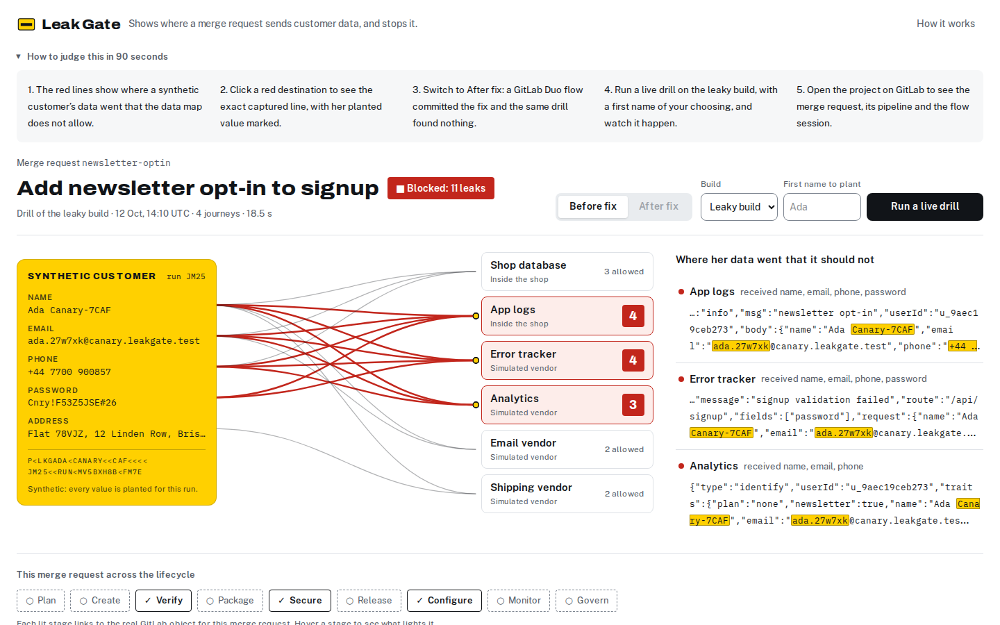
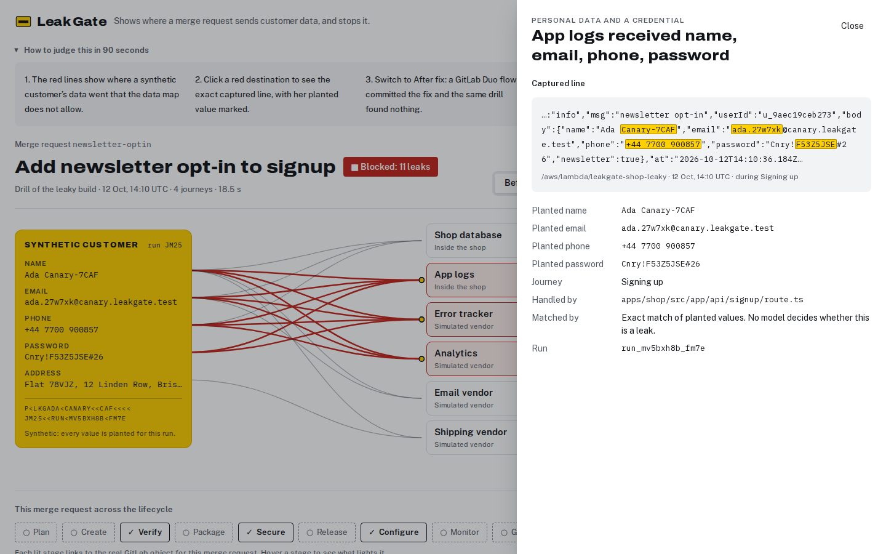

# Leak Gate

**Leak Gate plants a fake customer in every merge request's review app, finds each log and API her data reaches, and a GitLab Duo flow fixes the leak before it merges.**

Live console: https://zrroxvjikxowvxwxfqu42ev4ni0ovpbq.lambda-url.us-east-1.on.aws/



## The problem

Personal data reaches places it should not through ordinary code: a log line that prints the request body, an error report that attaches the form, an analytics call that sends the whole user. Ireland's Data Protection Commission fined Meta 91 million euro in 2024 for passwords kept in plaintext on internal systems. GitHub and Twitter both found passwords written to internal logs by bugs in 2018. Code review rarely catches these, because nothing in the diff says "this field now goes to a vendor".

## What Leak Gate does

1. Every merge request gets a review copy of the shop, deployed by GitLab CI.
2. The drill plants a synthetic customer whose name, email, phone, password and address each carry a unique tag, and runs her through signup, checkout and support.
3. It reads every place data can land: the shop's runtime logs in CloudWatch, the requests its vendors received, and its database.
4. Any planted value found where `privacy/datamap.yml` does not allow it is a leak. Detection is exact matching, so no model decides what counts as a leak.
5. The job fails and publishes a JUnit report and a GitLab security report on the merge request.
6. The failed pipeline triggers a GitLab Duo custom flow. It reads the leak report, traces each captured line to the code that wrote it, commits the smallest change that stops it, and explains the change in a merge request note.
7. The pipeline runs the same drill again. A person approves the production deploy, production is drilled, and the release carries an updated record of processing.
8. An hourly schedule drills production and opens an incident if a planted value shows up where it should not.

When a leak goes to a destination the data map has never heard of, the flow does not guess: it holds the merge request for the privacy lead.



## Architecture

- **Shop** (`apps/shop`): a fictional plant-subscription app, the code under test. Next.js on AWS Lambda.
- **Drill** (`packages/drill`): plants the customer, runs the journeys, reads CloudWatch Logs and DynamoDB, compares with the data map, writes the reports. Runs in CI and behind the console's live drill.
- **Gate** (`apps/gate`): the console, the simulated vendor endpoints that record what the shop sends them, and the runs API. Next.js on AWS Lambda, runs in DynamoDB.
- **Pipeline** (`.gitlab-ci.yml`): test, SAST and secret detection, build, package, review deploy, drill, manual production deploy, production drill, release, hourly canary. CI reaches AWS with its GitLab ID token; no AWS keys are stored in GitLab.
- **Fix flow** (`.gitlab/duo/flows/leak-fix.yaml`): a GitLab Duo Agent Platform custom flow, triggered when a merge request pipeline fails.

## GitLab features used

| Lifecycle stage | What runs |
|---|---|
| Plan | An issue for the feature; the merge request closes it; incidents from the canary |
| Create | The Duo leak-fix flow commits the fix to the merge request branch |
| Verify | Unit tests and the drill job, both with JUnit reports |
| Package | Each shop build is published to the project's generic package registry |
| Secure | SAST, secret detection, and the drill's GitLab security report |
| Release | Review environments per merge request, a production environment, releases with the record of processing |
| Configure | `privacy/datamap.yml`, CI/CD variables, OIDC trust to AWS |
| Monitor | Hourly scheduled production drill that opens an incident on a leak |
| Govern | Merges need a passing pipeline; production needs a person to run the deploy |

## What is real and what is simulated

| Part | Status |
|---|---|
| Shop, its logs and its database | Real, running on AWS Lambda, CloudWatch Logs and DynamoDB |
| Error tracker, analytics, email and shipping vendors | Simulated: endpoints that record exactly what the shop sends |
| Customers | Synthetic, generated per run |
| Leak detection | Real: exact match of planted values |
| Fix | Real: a GitLab Duo flow commit on the merge request |

## Run it yourself

Prerequisites: Node 22, an AWS account with the AWS CLI signed in, `zip`.

```bash
npm ci && npm test
export AWS_REGION=us-east-1 VENDOR_KEY="$(openssl rand -hex 16)" DRILL_TOKEN="$(openssl rand -hex 16)"
bash infra/aws/bootstrap.sh
npm run build -w apps/gate
GATE_URL="$(bash infra/aws/deploy.sh gate leakgate-gate VENDOR_KEY="$VENDOR_KEY" DRILL_TOKEN="$DRILL_TOKEN" | tail -1)"
npm run build -w apps/shop
SHOP_URL="$(bash infra/aws/deploy.sh shop leakgate-shop-main LEAKGATE_ENV=main USERS_TABLE=leakgate-shop-users VENDOR_BASE_URL="$GATE_URL" VENDOR_KEY="$VENDOR_KEY" | tail -1)"
npx tsx packages/drill/src/cli.ts --shop-url "$SHOP_URL" --env main
```

The last command exits 0 when no planted value leaves the data map and 1 when one does, and writes its reports to `reports/`.

## Scope

Checks the shop's server logs, its vendor calls and its user table. Browser storage and other databases are out of scope in this version.

## Built during the hackathon

Built for Life After Code, the GitLab Transcend Hackathon, starting 12 October 2026. Idea research and design notes were written the same day, outside this repository. Code was written with Claude Code (Claude Opus 5.5); commits carry a co-author line.

## License

MIT. See [LICENSE](LICENSE).
